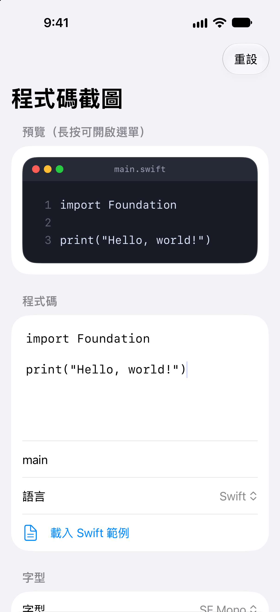
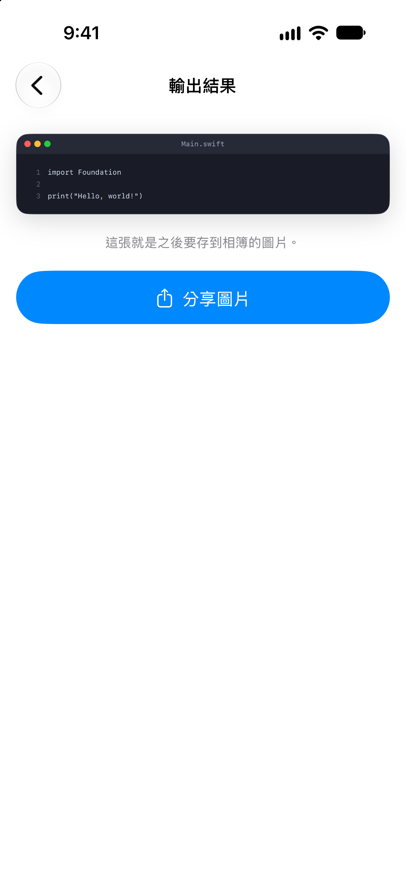

# CodeShot

CodeShot 是以 SwiftUI 開發的 iPhone 與 iPad App。貼上程式碼或純文字，即可預覽自訂的程式碼卡片，再將卡片輸出成圖片並分享。

 

## 功能

- 編輯內容或調整設定時，卡片會同步更新。長按預覽可複製程式碼、載入範例或開啟重設確認。
- 提供 Swift、C、C++、Python、Java、JavaScript、Rust 和純文字，共八種選項。語言決定卡片檔名的副檔名，例如 `.swift` 或 `.txt`。
- 可選擇八種字型，調整字級、粗體、文字、背景與標題列配色、內距、行距與圓角，並切換標題列、視窗三色點和行號。
- 使用 `ImageRenderer` 以 640 點寬、3 倍比例繪製卡片，輸出寬度為 1920 像素。可在結果頁透過系統分享選單分享圖片。

## 環境需求

- 搭載 macOS 的電腦，以及 Xcode 15 或更新版本。 [Xcode 15 版本說明](https://developer.apple.com/documentation/xcode-release-notes/xcode-15-release-notes/)
- iOS 或 iPadOS 16.0 以上。使用模擬器時，需在 Xcode 安裝對應的 iOS 模擬器執行環境。

## 執行專案

若已下載專案，可直接從 Xcode 開啟 `CodeShot.xcodeproj`。也可透過終端機取得並開啟專案。

```bash
git clone https://github.com/smallshawn95/CodeShot.git
cd CodeShot
open CodeShot.xcodeproj
```

1. 在 Xcode 上方選擇 `CodeShot` scheme。
2. 選擇 iPhone 或 iPad 模擬器，按 **⌘R** 執行。
3. 若要在實機執行，先在 `CodeShot` target 的 **Signing & Capabilities** 選擇開發團隊，必要時將 Bundle Identifier 改成可用的識別碼。

## 使用方式

1. 在「程式碼」區輸入或貼上內容，選擇語言並填寫檔名。按「載入範例」可帶入該語言的範例與預設檔名。
2. 依照即時預覽調整字型、顏色和版面。
3. 按「生成圖片」，在「輸出結果」頁按「分享圖片」。

## 專案結構

| 檔案或目錄 | 用途 |
| --- | --- |
| `CodeShot.xcodeproj/` | Xcode 專案、建置設定及共用 scheme |
| `CodeShot/CodeShotApp.swift` | App 進入點 |
| `CodeShot/ContentView.swift` | 編輯表單、即時預覽、圖片生成與提示 |
| `CodeShot/CodeCardView.swift` | 即時預覽與圖片輸出共用的卡片 |
| `CodeShot/CodeStyle.swift` | 卡片設定、檔名處理與字型選項 |
| `CodeShot/CodeLanguage.swift` | 語言選項、副檔名與範例 |
| `CodeShot/ResultView.swift` | 圖片結果與系統分享 |
| `CodeShot/Info.plist`、`CodeShot/Fonts/` | 自訂字型註冊、字型檔與授權文件 |

## 已知限制

- 程式碼以單一文字顏色呈現。
- 過長的程式碼行自動換行時，行號可能與內容錯位。

## 字型授權

隨專案提供的 Fira Code 與 JetBrains Mono 採用 SIL Open Font License 1.1。 [Fira Code 授權](CodeShot/Fonts/LICENSE-FiraCode.txt) · [JetBrains Mono 授權](CodeShot/Fonts/LICENSE-JetBrainsMono.txt)

## 專案來源

本專案源自彼得潘的 SwiftUI 作業 #233「結合各種輸入元件 & 顯示 alert」。
